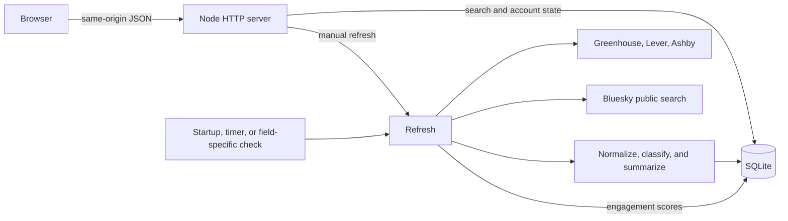
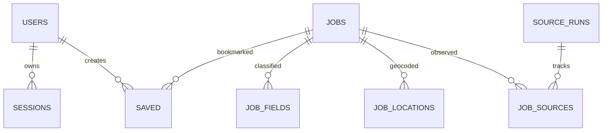

# Architecture and operations

## Catalog

The refresh process polls up to four boards at a time. Each provider maps its response to a shared job shape. The normalizer strips markup, extracts a role description and likely skills, classifies fields, and resolves US city/state pairs against the bundled data. Distance uses great-circle miles from the ZIP centroid to the nearest known office. ZIP results exclude ungeocoded locations and include remote roles when selected.

SQLite deduplicates by canonical HTTPS URL and uses FTS5 for keyword search. Join tables index fields and known office coordinates. Popularity uses bookmarks plus the sum of likes, replies, reposts, and quotes in a recent sample of Bluesky posts linking to the exact job URL. A successful snapshot marks omissions. A posting closes after two omissions across all sources that list it, or after seven days without a current source observation. Saved entries remain available after closure.

Add a source in [boards.json](../config/boards.json) with a provider, board slug, company display name, and applicable field IDs from [fields.js](../public/fields.js). An empty field list includes the source in every manual check. Restart the process after editing the config. New providers need an adapter that produces the same job shape. Employer access and reuse terms can vary by board.

## Operations

- `GET /api/health` checks the HTTP process and SQLite. `GET /api/refresh` reports board counts, last successful refresh, and failed feed counts. Add `?field=cs` to inspect a field.
- Keep a persistent writable volume for the SQLite directory and run one app replica. Database changes are transactional and SQLite uses WAL. Back up with SQLite’s online backup API or stop the app and copy the entire data directory together. Test restore into a separate volume.
- For a managed host, set `HOST=0.0.0.0`, honor the host’s port, attach a persistent disk, set `DB_PATH` to a writable path on it, and set `PUBLIC_ORIGIN` to the site’s HTTPS URL. For Docker Compose behind a host reverse proxy, point the proxy to `127.0.0.1:3000`. Use one trusted proxy that replaces or appends the actual client IP before setting `TRUST_PROXY=1`.
- Self-service accounts use email as the login identifier and local password storage with salted scrypt hashes. This release has no email verification, password recovery, or external identity provider.
- Run `node --test` locally. The GitHub workflow also builds the Docker image and smoke-tests a container. Tests use temporary in-memory databases and feed fixtures.
